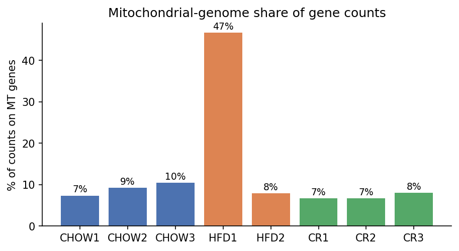
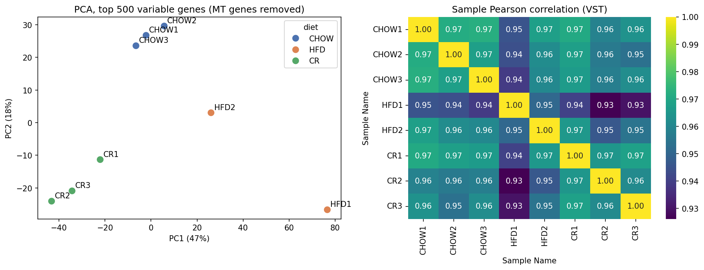
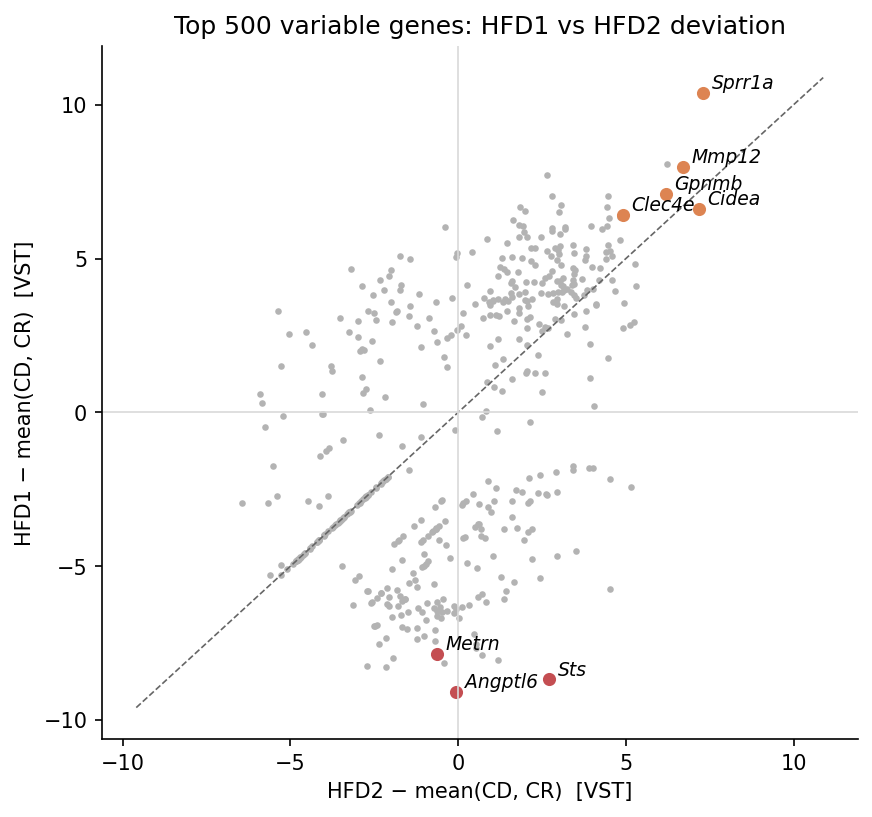
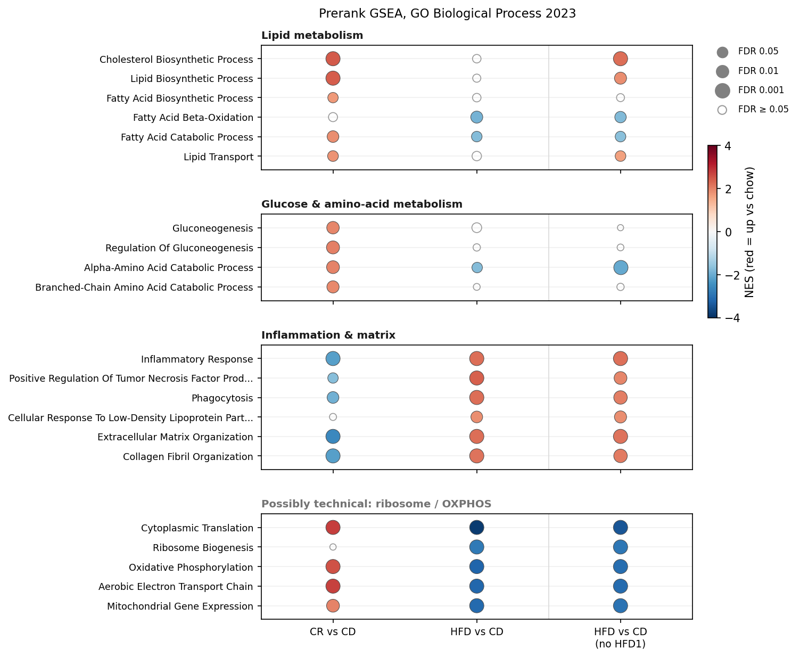

# Hepatic nutrient regulation

Reanalysis of mouse liver RNA-seq from male C57BL/6J mice kept on three diets:
normal chow (CD), high-fat diet (HFD) and calorie restriction (CR). The goal is
to measure how each diet changes liver gene expression and to compare the
results with the original study.

| | |
|---|---|
| Source | NCBI BioProject [PRJNA208469](https://www.ncbi.nlm.nih.gov/bioproject/PRJNA208469), SRA study SRP026039 |
| Organism | *Mus musculus*, C57BL/6J, male |
| Sequencer | Illumina Genome Analyzer II |
| Reference | GRCm39, Ensembl release 114 |
| Sample metadata | [data/metadata/SraRunTable.csv](data/metadata/SraRunTable.csv) |

The BioProject also contains PPARα / RXRα ChIP-seq and 4 DNase-seq runs. The
ChIP-seq pipeline setup is kept on the [`chipseq`](../../tree/chipseq) branch and
was not completed. The DNase-seq is not analyzed.

## Status

Pipeline outputs are in `results/`. The downstream analysis and
figures are in [analysis/hnr-de.ipynb](analysis/hnr-de.ipynb) and
[analysis/figures/](analysis/figures/).

## Repository layout

```
config/                 Workflow configuration (config.yaml, samples.tsv, units.tsv)
workflow/Snakefile      Imports snakemake-workflows/rna-seq-star-deseq2 v3.1.2
run_workflow.sh         SLURM submission script for the workflow
hnr-workspace/          pixi environment (Snakemake + SLURM executor plugin)
data/metadata/          SRA run table, accession list, sample sheet
analysis/hnr-de.ipynb   QC, pairwise differential expression and GSEA (pydeseq2, gseapy)
analysis/figures/       Figures exported by the notebook
```

These are generated, are not tracked in git, and are recreated by the pipeline:
`resources/` (genome, annotation, STAR index), `results/`, FASTQs and BAMs.

---

## Samples

Paired-end, 2 × 36 bp.

| Sample | SRA run | Diet (`diet` column) | Notebook label |
|---|---|---|---|
| GSM1163164 | SRR901041 | chow | CHOW1 |
| GSM1163165 | SRR901042 | chow | CHOW2 |
| GSM1163166 | SRR901043 | chow | CHOW3 |
| GSM1163167 | SRR901044 | hfd | HFD1 |
| GSM1163168 | SRR901045 | hfd | HFD2 |
| GSM1163169 | SRR901046 | calorie_restriction | CR1 |
| GSM1163170 | SRR901047 | calorie_restriction | CR2 |
| GSM1163171 | SRR901048 | calorie_restriction | CR3 |

The workflow reads the diet labels from [config/samples.tsv](config/samples.tsv).
The `high_fat` label in `data/metadata/samples.tsv` is not used.

## Method

### Pipeline (Snakemake)

The workflow is [snakemake-workflows/rna-seq-star-deseq2](https://github.com/snakemake-workflows/rna-seq-star-deseq2)
v3.1.2, configured in [config/config.yaml](config/config.yaml).

1. **Download and reference.** Reads come directly from SRA. The genome and
   annotation are Ensembl 114 GRCm39.
2. **Trimming.** fastp.
3. **Alignment and counting.** STAR 2.7.11b aligns the reads, and STAR's
   `--quantMode GeneCounts` counts reads per gene. The library is unstranded
   (RSeQC `infer_experiment` shows about a 40/40 split), so the unstranded count
   column is used.
4. **DESeq2.**
   - Design `~ diet`, with `chow` as the reference level.
   - Genes with ≤1 read in total across all samples are removed (28,478 of
     78,317 genes remain).
   - Default `DESeq()` fit, Wald test.
   - Log2 fold changes are shrunk with `lfcShrink(type = "ashr")`.
5. **PCA.** `rlog`-transformed counts (`blind = FALSE`), coloured by diet.

### Downstream analysis (notebook)

[analysis/hnr-de.ipynb](analysis/hnr-de.ipynb) starts from `results/counts/all.tsv`:

1. **Mitochondrial genes removed.** The 37 genes on seqname `MT` are dropped
   before every fit (see [Sample QC](#sample-qc-and-the-hfd1-outlier)).
2. **Sample QC.** Blind VST, PCA on the 500 most variable genes, Pearson
   correlation.
3. **Pairwise DESeq2 (pydeseq2), as in the paper.** CD vs CR and CD vs HFD are
   fit as separate two-group models. Genes need ≥10 reads in at least as many
   samples as the smallest group. DEGs: padj < 0.05 and |log2FC| ≥ 0.5.
4. **Sensitivity fit without HFD1.**
5. **Prerank GSEA (gseapy).** Protein-coding genes ranked by the DESeq2 Wald
   statistic, one entry per symbol. Gene sets: GO Biological Process 2023 (mouse),
   15–500 genes, 1000 permutations, seed 0.

### Running

```bash
sbatch run_workflow.sh   # pipeline, from the repo root

# notebook (needs internet for the gseapy gene-set download)
jupyter nbconvert --to notebook --execute --inplace analysis/hnr-de.ipynb
```

The script submits Snakemake through the SLURM executor (up to 20 concurrent jobs,
conda software environments). If a job fails, it is retried once with more memory
and runtime.

## Differences from the original study

| | Original study | This reanalysis | Expected impact |
|---|---|---|---|
| Aligner | TopHat, restricted to known splice junctions | STAR 2.7.11b with an annotation-built index; novel junctions allowed | Small. Gene-level counts from the two aligners are usually highly correlated, and few spliced reads fall on unannotated junctions. |
| Genome / annotation | mm9 (NCBI37) | GRCm39, Ensembl 114 | Moderate for gene-by-gene comparison: some genes are split, merged or new. Match on gene symbol. |
| Normalization | Conditional quantile normalization (CQN) for GC content and gene length | DESeq2 median-of-ratios size factors | Largest effect on DE lists, mostly for GC-extreme and very short or long genes. |
| Trimming | Not reported | fastp | Small. |
| DE filter | FPKM ≥ 0.1 | ≥10 reads in the smallest group's number of samples | Changes which low-expressed genes are tested. |
| Sample QC | No PCA or sample-correlation figure shown | PCA, correlation, mitochondrial-read share | Shows the HFD1 outlier described below. |

DEG counts (padj < 0.05, |log2FC| ≥ 0.5):

| Comparison | This analysis | Paper |
|---|---|---|
| CD vs CR | 2,158 | 2,724 |
| CD vs HFD | 1,918 | 2,830 |
| Shared | 418 | 695 |

## Sample QC and the HFD1 outlier

The original paper did not show a sample PCA. Here it shows one HFD sample,
GSM1163167 (HFD1), far from all other samples.



**47% of HFD1's counts fall on mitochondrial-genome genes**, against 7–10% in
every other sample, including the other HFD liver. A high mitochondrial share
usually means RNA degradation or cell damage during extraction: transcripts
inside mitochondria are protected, while cytoplasmic mRNA is lost. HFD1 also has
the highest multimapping rate (21.8%, others 13.8–16.2%), as expected when many
reads come from the mitochondrial genome and its nuclear copies.



Removing the 37 MT genes barely moves HFD1 on the PCA (PC1 77.0 → 76.6), and
neither does keeping only well-expressed or protein-coding genes. HFD1 lies on
the same PC1 axis as the diet effect (CR negative, chow near 0, HFD positive), but
about three times further out than HFD2.



Comparing each HFD sample with the mean of the other samples separates two
groups of genes:

- **Shared HFD signal** (upper right). Genes up in both HFD livers but more in
  HFD1: *Cidea*, *Gpnmb*, *Mmp12*, *Clec4e*, *Sprr1a*. These are markers of
  steatosis and lipid-associated macrophages.
- **HFD1-only dropouts** (bottom). Genes near zero in HFD1 but normal in HFD2:
  *Angptl6*, *Sts*, *Metrn* and several ribosomal pseudogenes. This pattern fits
  a degraded library.

HFD1 therefore looks like part stronger HFD responder, part damaged library. It
is kept in the main analysis, because dropping it leaves n=1 HFD. Every HFD
result is also checked against a fit without it.

Other QC points:

- **All samples are male.** Y-chromosome genes are expressed and *Xist* is about 0,
  which matches the SRA metadata.
- **The ribosomal-protein share of reads varies tenfold** (0.3–3.2% of normalized
  counts): lowest in HFD and highest in CR. This is a likely source of technical
  difference between samples.
- **STAR's per-base mismatch rate is high** (1.9–3.2%). That is typical of older
  Genome Analyzer II data.

| Sample | Diet | Read pairs | Uniquely mapped | MT share of counts |
|---|---|---|---|---|
| GSM1163164 | chow | 36.6 M | 73.7% | 7.4% |
| GSM1163165 | chow | 31.1 M | 73.2% | 9.2% |
| GSM1163166 | chow | 34.2 M | 72.9% | 10.5% |
| GSM1163167 | hfd | 36.3 M | 73.5% | **46.7%** |
| GSM1163168 | hfd | 24.6 M | 78.8% | 7.9% |
| GSM1163169 | CR | 37.4 M | 79.4% | 6.7% |
| GSM1163170 | CR | 19.5 M | 76.6% | 6.7% |
| GSM1163171 | CR | 30.1 M | 79.5% | 8.1% |

## Pathway enrichment (GSEA)



Each column is one contrast against chow, and the third column repeats HFD vs
chow without HFD1. Colour is the normalized enrichment score (NES): red means the
pathway is shifted up relative to chow, blue down. Dot size is −log10 FDR, and
hollow dots are FDR ≥ 0.05. Rows are selected GO terms grouped by theme, taken
from terms significant in at least one main contrast, with near-duplicates
collapsed. The full results and leading-edge genes are in the notebook.

| Contrast | Terms at FDR < 0.05 | Up | Down |
|---|---|---|---|
| CR vs CD | 251 | 62 | 189 |
| HFD vs CD | 422 | 343 | 79 |
| HFD vs CD, without HFD1 | 634 | 521 | 113 |

## Biological interpretation

- **Calorie restriction shifts the liver towards synthesis and gluconeogenesis.**
  Cholesterol, sterol and lipid biosynthesis, gluconeogenesis and amino-acid
  catabolism (including branched-chain) are shifted up. Inflammatory response,
  TNF production, phagocytosis and extracellular-matrix / collagen organization
  are shifted down.
- **HFD has the opposite effect on inflammation and matrix.** Inflammatory
  response, TNF production, phagocytosis, response to LDL and ECM / collagen
  terms are shifted up, along with marker genes such as *Gpnmb*, *Mmp12* and
  *Clec4e*. This is consistent with macrophage infiltration and early fibrotic
  remodelling. Fatty-acid β-oxidation, fatty-acid catabolism and α-amino-acid
  catabolism are shifted down.
- **HFD1 masks part of the HFD response.** HFD NES values with and without HFD1
  agree well (Spearman ρ 0.88 over 2,091 terms). Without HFD1, cholesterol and
  lipid biosynthesis also become significantly up in HFD.
- **Ribosome / translation and OXPHOS terms are not interpreted.** They are the
  strongest terms overall, up in CR and down in HFD. However, they follow the
  sample-to-sample variation in ribosomal-protein reads and HFD1's library
  quality, so they may be largely technical.
- **Limits.** HFD has only two replicates, one of them compromised. Treat the
  HFD results as provisional.

---

## Results guide (Snakemake pipeline)

All paths are relative to `results/`.

### `counts/`: raw counts

| File | Contents |
|---|---|
| `all.tsv` | Raw read counts. Rows are Ensembl gene IDs (`ENSMUSG…`), columns are samples. This is the input to DESeq2 and to the notebook. |
| `all.symbol.tsv` | The same matrix with gene symbols in place of IDs. Display only, not used downstream. |

Raw counts are not normalized for sequencing depth, so compare samples with
`deseq2/normcounts.tsv` instead.

### `deseq2/`: fitted model and normalized counts

| File | Contents |
|---|---|
| `all.rds` | The fitted `DESeqDataSet`. Load it in R with `readRDS()` to run new contrasts, `vst()`/`rlog()`, or `plotCounts()`. |
| `normcounts.tsv` | Counts divided by DESeq2 size factors (sequencing-depth normalized), after the ≤1-read filter. |
| `normcounts.symbol.tsv` | The same, with gene symbols. |

Normalized counts are comparable between samples for the same gene. They are not
adjusted for gene length, so they should not be used to compare expression
between different genes.

### `diffexp/`: differential expression, one set per contrast

These are from the pipeline's single 3-group model (with MT genes included). The
notebook's pairwise results are the ones used in the write-up above.

| Contrast | Comparison |
|---|---|
| `hfd_vs_chow` | HFD vs chow |
| `cr_vs_chow` | CR vs chow |
| `cr_vs_hfd` | CR vs HFD |

| File | Contents |
|---|---|
| `<contrast>.diffexp.tsv` | DESeq2 results with Ensembl IDs, sorted by `padj`. |
| `<contrast>.diffexp.symbol.tsv` | The same, with gene symbols. |
| `<contrast>.ma-plot.svg` | MA plot (y-axis fixed to ±2). |

Columns in the results tables:

| Column | Meaning |
|---|---|
| `gene` | Ensembl ID or gene symbol |
| `baseMean` | Mean normalized count across all 8 samples |
| `log2FoldChange` | ashr-shrunken log2 fold change (first group / second group) |
| `lfcSE` | Posterior standard deviation of the shrunken log2 fold change |
| `pvalue` | Wald test p-value. It comes from the unshrunken estimate, so it isn't affected by shrinkage. |
| `padj` | Benjamini–Hochberg adjusted p-value |

Notes for reading the tables:

- **`padj` is `NA` for 10,000–14,000 genes per contrast.** DESeq2's independent
  filtering removes these low-count genes before multiple-testing correction.
  Treat them as "not tested", not "not significant".
- **The fold changes are shrunk.** Shrinkage pulls the fold changes of noisy,
  low-count genes toward 0. That makes them suitable for ranking, but they are
  smaller than unshrunken values.
- **Some symbols are duplicated.** 18 symbols map to more than one Ensembl ID.
  Genes with no symbol keep their Ensembl ID. Use the `.diffexp.tsv` files when
  you need unique identifiers.
- **Significant genes per contrast** (`padj < 0.05`, \|log2FC\| ≥ 1):

  | Contrast | DE genes | Up | Down |
  |---|---|---|---|
  | `hfd_vs_chow` | 1,617 | 874 | 743 |
  | `cr_vs_chow` | 503 | 314 | 189 |
  | `cr_vs_hfd` | 3,367 | 1,663 | 1,704 |

### `qc/` and `pca.diet.svg`

| Path | Contents |
|---|---|
| `qc/multiqc_report.html` | Combined QC report: fastp, STAR, RSeQC |
| `qc/rseqc/` | Per-sample RSeQC output: strandedness, read distribution, duplication, GC, junctions, inner distance |
| `pca.diet.svg` | PCA of rlog-transformed counts, coloured by diet |
| `star/<sample>/` | STAR BAMs, `Log.final.out` (mapping stats), `ReadsPerGene.out.tab` |

---

## Software

| Component | Version |
|---|---|
| Snakemake | ≥ 9.27.1 (pixi, `hnr-workspace/`) |
| snakemake-executor-plugin-slurm | ≥ 2.8.0 |
| rna-seq-star-deseq2 | v3.1.2 |
| STAR | 2.7.11b |
| pydeseq2 | 0.5.4 |
| gseapy | 1.3.2 |

The exact versions of every pipeline tool are recorded in
`hnr-workspace/pixi.lock` and the Snakemake conda environments.
